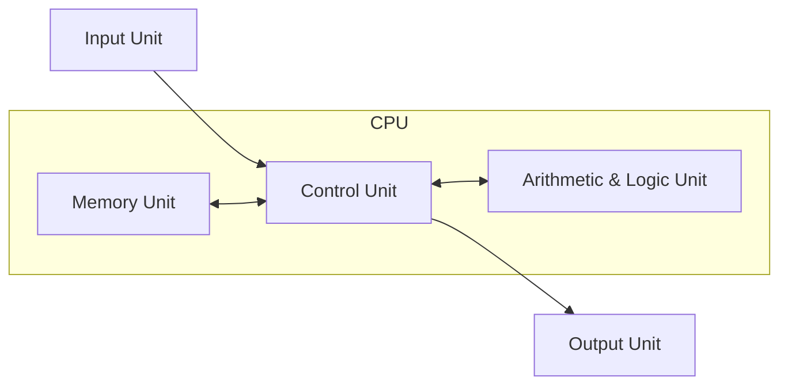
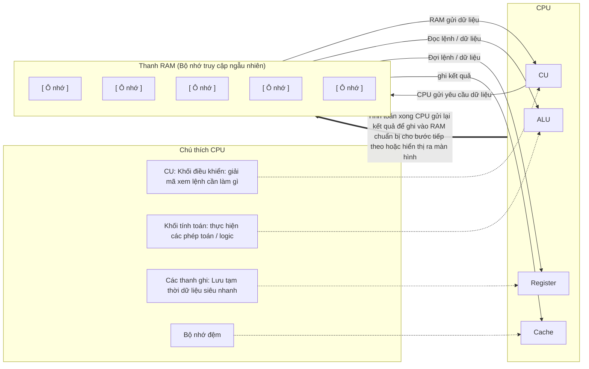

# Giới thiệu hệ thống máy tính

- Hệ thống máy tính là sự kết hợp của phần cứng, phần mềm và dữ liệu được sử dụng để giải quyết vấn đề của con người
  + Phần cứng (Hardware) : Các linh kiện vật lí (CPU, RAM, ổ cứng,...)
  + Phần mềm (Software) : Tập hợp các lệnh chỉ dẫn máy tính cần làm gì (thực chất là các chương trình như Chrome,...)
  + Dữ liệu (Data) : Thông tin thô cần xử lí (văn bản, hình ảnh, video). Không có dữ liệu, phần mềm trở nên vô nghĩa

- Mô hình chương trình lưu trữ
  + Máy tính hiện đại vận hành dựa trên nguyên lí then chốt : Muốn chạy được, chương trình phải được nạp vào bộ nhớ



```text
+------------+          +-------------------------------------+          +-------------+
|            |          |                 CPU                 |          |             |
|            |          |  +-------------------------------+  |          |             |
|            |          |  |          Memory Unit          |  |          |             |
|            |          |  +-------------------------------+  |          |             |
|            |          |                 ^                   |          |             |
|            |          |                 |                   |          |             |
|            |          |                 v                   |          |             |
|            |          |  +-------------------------------+  |          |             |
| Input Unit | -------->|  |         Control Unit          |  |--------> | Output Unit |
|            |          |  +-------------------------------+  |          |             |
|            |          |                 ^                   |          |             |
|            |          |                 |                   |          |             |
|            |          |                 v                   |          |             |
|            |          |  +-------------------------------+  |          |             |
|            |          |  |    Arithmetic & Logic Unit    |  |          |             |
|            |          |  +-------------------------------+  |          |             |
+------------+          +-------------------------------------+          +-------------+
```

++) Khi bạn muốn chỉnh sửa hình ảnh, phần mềm (chương trình) và bức ảnh (dữ liệu) sẽ được đưa vào bộ nhớ  
++) CPU đóng vai trò như bộ não : liên tục tìm nạp dữ liệu (fetch), giải mã (decode) và thực thi (execute) từng chỉ thị từ bộ nhớ với tốc độ cực cao

---

• Tại sao máy tính cần phân cấp bộ nhớ (Memory hierarchy)
- Tại sao không lưu tất cả vào một nơi duy nhất mà phải chia ra ổ cứng, RAM rồi đến Cache và Register?
=> Câu trả lời nằm ở bài toán đánh đổi giữa tốc độ truy xuất và tính bền vững của dữ liệu

| | Ổ cứng (HDD / SSD) | RAM (Bộ nhớ chính) |
| :--- | :--- | :--- |
| **Bảo toàn dữ liệu** | - Không mất dữ liệu : Tắt máy hay mất điện, dữ liệu vẫn còn nguyên | - Mất dữ liệu khi mất điện : Dữ liệu biến mất ngay lập tức khi ngắt nguồn |
| **Tốc độ truy xuất** | Rất chậm (tính bằng mili giây hoặc micro giây) | - Cực kì nhanh (tính bằng nano giây), nhanh hơn cả ổ cứng trăm đến hàng chục nghìn lần |
| **Giá và Dung lượng** | Rẻ trên mỗi GB, dung lượng lưu trữ lớn (hàng trăm GB đến TB) | Đắt hơn nhiều, dung lượng giới hạn 8GB - 64GB |

- Chúng ta muốn cả 2 : Dữ liệu vừa phải được lưu vĩnh viễn, vừa phải được CPU xử lí với tốc độ tối đa
=> Vì vậy hệ thống hoạt động theo nguyên lí "Copy - Paste" chứ không phải "Cut - Paste"
  + Lưu trữ tĩnh : mọi phần mềm và tệp tin luôn nằm an toàn trên ổ đĩa
  + Nạp khi thực thi : Khi bạn mở một ứng dụng ví dụ Word, hệ thống sẽ tạo một bản sao của chương trình cùng dữ liệu liên quan từ ổ cứng sang RAM
  + CPU làm việc trực tiếp với RAM : nhờ tốc độ của RAM, CPU không bị nghẽn cổ chai và có thể chạy hết công suất
  + An toàn dữ liệu : Nếu mất điện đột ngột, bản gốc trên đĩa cứng vẫn nguyên vẹn

- Các tầng bộ nhớ sâu hơn như Cache hay Register nằm trực tiếp trên CPU để phục vụ tối ưu kiến trúc phần cứng, còn đối với hệ điều hành, mối quan hệ giữa RAM và ổ cứng là nền tảng cốt lõi cần nắm vững trước tiên



```text
                                       +-------------------------------+                          +----------+
CU: Khối điều khiển: giải mã xem       |              CPU              |                          |   RAM    |  RAM
lệnh cần làm gì                        |  +-------------------------+  | CPU gửi yêu cầu dữ liệu  | +------+ |  (Bộ nhớ truy cập
   ----------------------------------->|  |           CU            |  |------------------------->| |      | |   ngẫu nhiên)
                                       |  +-------------------------+  |                          | +------+ |
Khối tính toán: thực hiện các phép     |  +-------------------------+  | RAM gửi dữ liệu          | +------+ |
toán / logic                           |  |          ALU            |  |<-------------------------| |      | |
   ----------------------------------->|  |                         |  |                          | +------+ |
                                       |  +-------------------------+  | Đọc lệnh / dữ liệu       | +------+ |
Các thanh ghi: Lưu tạm thời            |  +-------------------------+  |<-------------------------| |      | |
dữ liệu siêu nhanh                     |  |        Register         |  |                          | +------+ |
   ----------------------------------->|  |                         |  | Đợi lệnh / dữ liệu       | +------+ |
                                       |  +-------------------------+  |<-------------------------| |      | |
Bộ nhớ đệm                             |  +-------------------------+  |                          | +------+ |
   ----------------------------------->|  |          Cache          |  | ghi kết quả              | |      | |
                                       |  +-------------------------+  |<-------------------------| +------+ |
                                       +---------------+---------------+                          +----+-----+
                                                       |                                               ^
                                                       | Tính toán xong CPU gửi lại kết quả để ghi     |
                                                       +-----------------------------------------------+
                                                         vào RAM chuẩn bị cho bước tiếp theo hoặc
                                                         hiển thị ra màn hình
```

- Khi đã hiểu CPU tương tác với RAM và ổ cứng, câu hỏi tiếp theo là: "Ai là người chịu trách nhiệm tải chương trình từ đĩa vào RAM, quản lí không gian RAM để các phần mềm không ghi đè lên nhau, và điều phối CPU chạy luân phiên giữa các ứng dụng?"
=> Đó là nhiệm vụ của HĐH