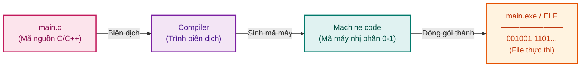

# Cách các thiết bị hoạt động cùng nhau

- Khi người dùng viết phần mềm bằng ngôn ngữ lập trình bậc cao (C, C++, Java, Python,...) mục đích cuối cùng để CPU thực thi. Tuy nhiên CPU là một mạch số thuần túy - nó không thể hiểu được cú pháp tiếng Anh hay các biến số trừu tượng. CPU chỉ hiểu mã máy (Machine code), tức là các chuỗi nhị phân của các số 0 và 1 (các lệnh mã hóa tập lệnh ISA như x86, ARM)



+ Trình biên dịch (Compiler) : Đóng vai trò làm thông dịch viên chuyển toàn bộ mã nguồn cấp cao thành tệp thực thi chứa mã máy ví dụ như .exe trên Windows hay định dạng ELF trên Linux
+ Nơi lưu trữ ban đầu : Sau khi biên dịch hoặc cài đặt, tệp thực thi này sẽ được ghi vào ổ cứng (Secondary Storage) dưới dạng một chương trình tĩnh (Passive Entity)

- Tại sao CPU không nạp toàn bộ mọi thứ vào RAM để chạy, hoặc không đọc trực tiếp từ ổ cứng?

+ Ta quay lại bảng so sánh ổ cứng (HDD/SSD) và RAM

| | Ổ cứng (HDD / SSD) | RAM (Bộ nhớ chính) |
| :--- | :--- | :--- |
| **Giá thành và dung lượng** | - Giá thành trên mỗi gigabyte rất rẻ -> Dung lượng rất lớn (500 GB - vài TB) | - Giá thành đắt đỏ -> Dung lượng bị giới hạn (8GB - 64GB) |
| **Tốc độ truy xuất** | Cực kì chậm (mili giây trên HDD, micro giây trên SSD) | Cực kì nhanh (tính bằng nano giây) |
| **Khả năng chứa dữ liệu** | Dư sức chứa hàng trăm phần mềm và dữ liệu lớn | Không thể chứa cùng lúc tất cả dữ liệu trên ổ cứng |

=> Vì sự chênh lệch dung lượng quá lớn, RAM chỉ có thể là không gian lưu trữ tạm thời cho những gì thực sự đang cần dùng

- Về mặt kiến trúc máy tính, CPU không bao giờ nạp từng lệnh thực thi trực tiếp từ các sector của đĩa cứng vì độ trễ I/O quá lớn sẽ làm CPU rơi vào trạng thái nhàn rỗi (idle) liên tục. CPU chỉ giao tiếp trực tiếp với bộ nhớ RAM

- Khi người dùng lệnh chạy một tiến trình

```mermaid
flowchart TD
    classDef cpuStyle fill:#e3f2fd,stroke:#1565c0,stroke-width:2px,color:#0d47a1;
    classDef ramStyle fill:#e8f5e9,stroke:#2e7d32,stroke-width:2px,color:#1b5e20;
    classDef diskStyle fill:#fff3e0,stroke:#e65100,stroke-width:2px,color:#bf360c;

    CPU{{ "CPU (Bộ vi xử lý)" }}:::cpuStyle
    RAM["RAM (DRAM - Bộ nhớ chính)<br/>Tốc độ nano giây"]:::ramStyle
    DISK[( "Ổ cứng (Disk HDD/SSD)<br/>━━━━━━━━━━━━━━━━━━<br/>Dung lượng lớn | Độ trễ cao" )]:::diskStyle

    CPU <==> |"Truy xuất Bus tốc độ cao (Nano giây)"| RAM
    RAM <==> |"Sao chép qua I/O controller khi thiếu trang (Micro / Mili giây)"| DISK
```

+ Kịch bản 1: Chương trình P1 đã nạp sẵn ở trong RAM (tối ưu)
++) Quy trình : CPU phát tín hiệu yêu cầu chỉ thị từ P1. Vì mã lệnh đã nằm trong không gian địa chỉ của RAM, CPU chỉ việc tìm nạp (fetch) và thực thi (execute) trên bus hệ thống

```mermaid
flowchart LR
    classDef cpuStyle fill:#e3f2fd,stroke:#1565c0,stroke-width:2px,color:#0d47a1;
    classDef ramSlot fill:#e8f5e9,stroke:#2e7d32,stroke-width:1.5px,color:#1b5e20;
    classDef emptySlot fill:#f5f5f5,stroke:#bdbdbd,stroke-width:1px,color:#9e9e9e;

    CPU{{ "CPU" }}:::cpuStyle

    subgraph RAM_STICK ["Thanh RAM (Bộ nhớ chính)"]
        direction TB
        R1["Chương trình P1<br/>(Đã được sao chép sẵn trong RAM)"]:::ramSlot
        R2["[ Khung trang trống ]"]:::emptySlot
        R3["[ Khung trang trống ]"]:::emptySlot
    end

    CPU <--> |"Tìm nạp & thực thi<br/>(Chỉ vài nano giây)"| R1
```

++ Thời gian xử lí : Cực ngắn (vài nano giây). Toàn bộ hệ thống chạy ở vận tốc tối đa của phần cứng

- Kịch bản 2: Chương trình P1 chưa có trong RAM => Xảy ra tắc nghẽn I/O
+ Quy trình : 
    ++ Hệ thống phát hiện chương trình P1 không nằm trong RAM
    ++ Hệ điều hành phải điều khiển bộ điều khiển đĩa (Disk Controller) định vị và đọc dữ liệu của P1 từ các khối trên ổ cứng
    ++ Dữ liệu mã máy được sao chép từ ổ cứng sang các khung trang trống trong RAM
    ++ Sau khi nạp xong vào RAM, CPU mới bắt đầu đọc lệnh từ RAM để thực thi

```mermaid
flowchart LR
    classDef cpuStyle fill:#e3f2fd,stroke:#1565c0,stroke-width:2px,color:#0d47a1;
    classDef ramSlot fill:#e8f5e9,stroke:#2e7d32,stroke-width:1.5px,color:#1b5e20;
    classDef emptySlot fill:#f5f5f5,stroke:#bdbdbd,stroke-width:1px,color:#9e9e9e;
    classDef diskStyle fill:#fff3e0,stroke:#e65100,stroke-width:2px,color:#bf360c;

    CPU{{ "CPU" }}:::cpuStyle

    subgraph RAM_STICK ["Thanh RAM"]
        direction TB
        M1["[ Khung trang trống ]"]:::emptySlot
        M2["[ Khung trang trống ]"]:::emptySlot
        P1_RAM["P1 (Bản sao trong RAM)"]:::ramSlot
    end

    subgraph DISK_DEV ["Ổ cứng (HDD/SSD)"]
        direction TB
        DISK_PLATTER[( "Đĩa từ / Chip nhớ Flash" )]:::diskStyle
        P1_DISK["P1 (Bản gốc tĩnh)"]:::diskStyle
    end

    P1_DISK -. "1. Sao chép P1 vào RAM qua Disk Controller<br/>(Seek time + Read latency rất chậm)" .-> P1_RAM
    P1_RAM --> |"2. CPU đọc và thực thi lệnh"| CPU
```

+ Thời gian xử lí : Rất dài. Toàn bộ thời gian truy xuất ổ cứng (Seek time, Rotational latency hay SSD NAND read latency) cộng thêm thời gian truyền tải số khối thô từ ổ cứng làm cho CPU luôn có độ trễ nhàn rỗi

=> Như vậy, cốt lõi của một chương trình là sử dụng RAM như một bộ đệm tốc độ cao cho ổ cứng. Khi một chương trình bắt đầu chạy trong RAM, nó không còn đơn thuần là một tệp mã máy tĩnh nữa, nó trở thành một tiến trình (Process)
