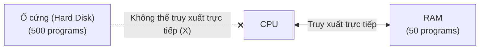
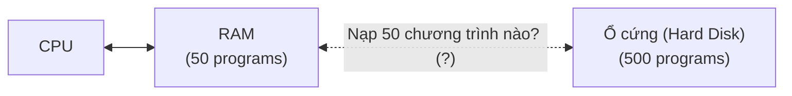
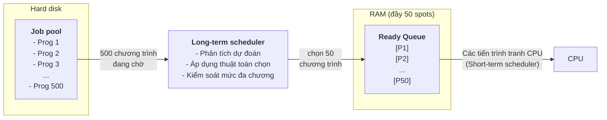
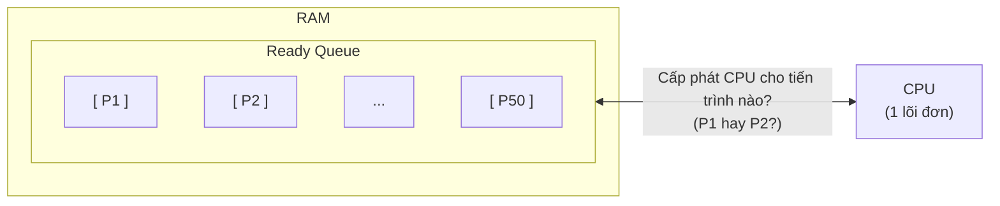
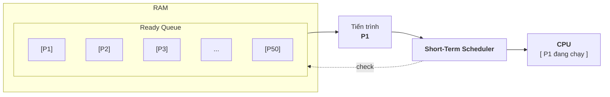

# Bài 3: Nhu cầu xây dựng hệ điều hành từ đầu

- Hệ điều hành (Operating System - OS) thực chất là một hệ thống phần mềm lớn đóng vai trò cốt lõi là **Bộ quản trị và phân bổ tài nguyên** (Resource Allocator / Resource Manager)
- Bản chất của máy tính là sự cạnh tranh giữa các chương trình để sử dụng các tài nguyên phần cứng giới hạn (RAM, CPU, ổ cứng, thiết bị I/O). Để giải quyết bài toán này, hệ điều hành chia nhỏ nhiệm vụ cho các module chức năng chuyên trách, tiêu biểu là 2 bộ lập lịch dưới đây:

---

## 1. Bài toán phân bổ RAM: Bộ lập lịch dài hạn (Long-term scheduler)

### Bối cảnh:
- **Ổ cứng (Hard Disk):** Lưu trữ khối lượng lớn (Ví dụ: 500 chương trình), nhưng CPU không thể truy xuất trực tiếp dữ liệu / lệnh từ ổ cứng để thực thi.
- **RAM:** Có tốc độ cao và CPU truy xuất trực tiếp được, nhưng dung lượng có hạn (Ví dụ: chỉ chứa tối đa 50 chương trình cùng lúc).



```text
+-------------------+                    +---------+                   +------------------+
|     Hard Disk     |         X          |   CPU   |                   |       RAM        |
|   (500 programs)  | < - - - - - - - - >|         | <===============> |  (50 programs)   |
| (Lưu trữ lớn, chậm) | Không thể truy xuất|         | Truy xuất trực tiếp| (Tốc độ cao,     |
+-------------------+     trực tiếp      +---------+                   |  dung lượng hạn chế)
                                                                       +------------------+
```

---

### Vấn đề đặt ra:
- Trong số 500 chương trình trên đĩa cứng, 50 chương trình nào sẽ được nạp vào RAM trước?



```text
+---------+                   +------------------+     Nạp 50 chương trình nào?     +-------------------+
|   CPU   |                   |       RAM        |                ?                 |     Hard Disk     |
|         | <===============> |  (50 programs)   | < - - - - - - - - - - - - - - - >|   (500 programs)  |
|         |    Truy xuất      |                  |                                  |                   |
+---------+    trực tiếp      +------------------+                                  +-------------------+
```

- **Mục tiêu tối ưu:** Lý tưởng nhất là giữ sẵn trong RAM những chương trình mà CPU có xác suất cần dùng cao nhất trong tương lai gần. Nếu CPU tìm thấy chương trình ngay trong RAM, thời gian đáp ứng cực nhanh; ngược lại, nếu phải sinh truy xuất từ đĩa cứng, hệ thống sẽ trễ rất lớn.
- **Giải pháp kĩ thuật:** Hệ điều hành không thể biết chính xác 100% tương lai, do đó nó sử dụng các thuật toán dự đoán và chính sách nạp.
- **Module đảm trách:** **Bộ lập lịch dài hạn (Long-Term Scheduler)** hay còn gọi là **Job Scheduler**. Chức năng này quyết định mức độ đa chương (**Degree of multiprogramming**) bằng cách chọn lọc các tác vụ từ hàng đợi trên đĩa cứng (**Job Pool**) nạp vào bộ nhớ RAM.



```text
+-----------------+      500 chương trình      +-------------------------+      chọn 50       +--------------------+      Các tiến trình tranh CPU     +---------+
|    Hard disk    |          đang chờ          |   Long-term scheduler   |    chương trình    |    Ready Queue     |        (Short-term scheduler)     |   CPU   |
|  +-----------+  | -------------------------> | - Phân tích dự đoán     | -----------------> |  +--------------+  | --------------------------------> |         |
|  | Job pool  |  |                            | - Áp dụng thuật toán    |                    |  | [P1]         |  |                                   +---------+
|  | - Prog 1  |  |                            |   chọn                  |                    |  | [P2]         |  |
|  | - Prog 2  |  |                            | - Kiểm soát mức đa      |                    |  | ...          |  |
|  | - Prog 3  |  |                            |   chương                |                    |  | [P50]        |  |
|  | ...       |  |                            +-------------------------+                    |  +--------------+  |
|  | - Prog 500|  |                                                                           +--------------------+
|  +-----------+  |                                                                                  RAM đầy
+-----------------+                                                                                 (50 spots)
```

=> **Như vậy:** Bộ lập lịch dài hạn (Long-term scheduler) kiểm soát số lượng tiến trình trong RAM, cân bằng giữa tác vụ I/O và tác vụ CPU.

---

## 2. Bài toán phân bổ CPU: Bộ lập lịch ngắn hạn (Short-Term scheduler)

### Bối cảnh:
- Khi các chương trình được nạp thành công vào RAM (lúc này được gọi là các tiến trình - **Processes**), chúng đều ở trạng thái sẵn sàng (**Ready**) để chạy.



```text
+--------------------------------+
|              RAM               |
|  +--------------------------+  |
|  |       Ready Queue        |  |
|  | +----------------------+ |  |
|  | | [P1]                 | |  |
|  | +----------------------+ |  |
|  | +----------------------+ |  |                      +---------+
|  | | [P2]                 | |  | <==================> |   CPU   |
|  | +----------------------+ |  |  Cấp phát CPU cho    | (1 lõi) |
|  | | ...                  | |  |  tiến trình nào?     +---------+
|  | +----------------------+ |  |  (P1 hay P2?)
|  | +----------------------+ |  |
|  | | [P50]                | |  |
|  | +----------------------+ |  |
|  +--------------------------+  |
+--------------------------------+
```

### Vấn đề đặt ra:
- CPU tại 1 thời điểm với 1 lõi đơn chỉ có thể xử lí một tiến trình. Vậy tiến trình nào? ($P_1$ hay $P_2$) sẽ được cấp phát CPU trước?

### Giải pháp:
- Hệ điều hành áp dụng các thuật toán định thời CPU cụ thể, ví dụ:
  + Tiến trình nào vào RAM trước thì chạy trước (**FCFS** - First-Come, First-Served)
  + Tiến trình có thời gian thực thi ngắn nhất được ưu tiên (**SJF** - Shortest Job First)
  + Phân chia theo độ ưu tiên hoặc kích thước / loại tác vụ

### Module đảm trách:
- **Bộ lập lịch ngắn hạn (Short-Term Scheduler)** hay còn gọi là **CPU scheduler**.
- Chức năng này chạy với tần suất rất cao (thường ở mức mili giây) để liên tục chọn tiến trình sẵn sàng tiếp theo và giao quyền kiểm soát CPU (thông qua Dispatcher). Tại đây, CPU chính là tài nguyên đang được phân bổ.



```text
+--------------------+
|        RAM         |                      check
|  +---------------+ | < - - - - - - - - - - - - - - - - - - - - - -+
|  |  Ready Queue  | |                                              |
|  |  +---------+  | |       +------+      +----------------------+ |      +-----------------+
|  |  |  [P1]   |  | | ----> |  P1  | ---> | Short-Term Scheduler | +----> |       CPU       |
|  |  +---------+  | |       +------+      +----------------------+        |  +-----------+  |
|  |  +---------+  | |      (Process)                                      |  |    P1     |  |
|  |  |  [P2]   |  | |                                                     |  +-----------+  |
|  |  +---------+  | |                                                     +-----------------+
|  |  +---------+  | |
|  |  |  [P3]   |  | |
|  |  +---------+  | |
|  |  |   ...   |  | |
|  |  +---------+  | |
|  |  |  [P50]  |  | |
|  |  +---------+  | |
|  +---------------+ |
+--------------------+
```

=> **Short-Term Scheduler** chính là bộ phân bổ tài nguyên CPU theo thời gian thực. Nhiệm vụ cốt lõi của nó là điều phối dòng tiến trình từ Ready Queue lên CPU một cách nhanh và chính xác nhất, đảm bảo CPU không bao giờ rơi vào trạng thái rảnh rỗi vô ích.
