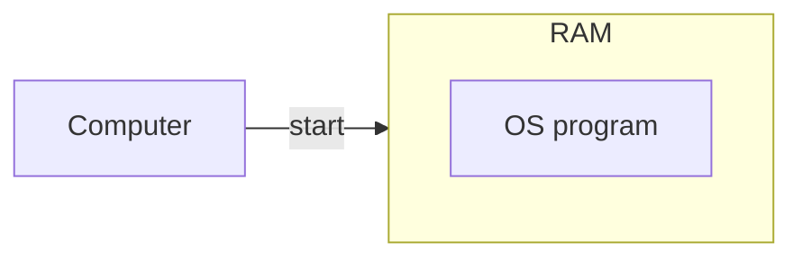
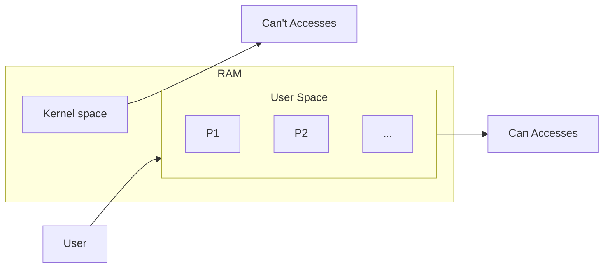
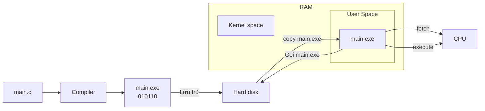
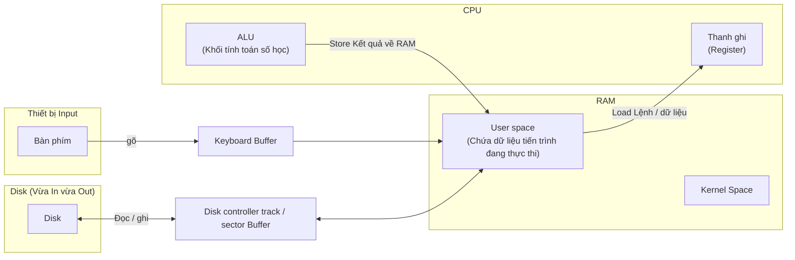
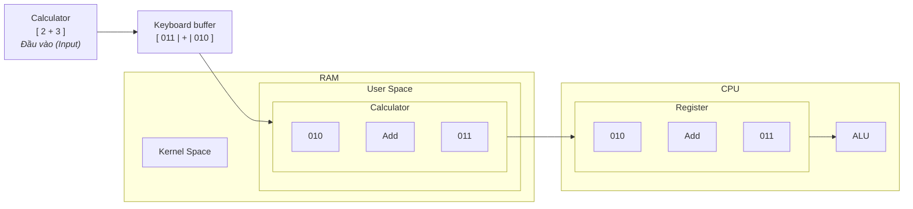
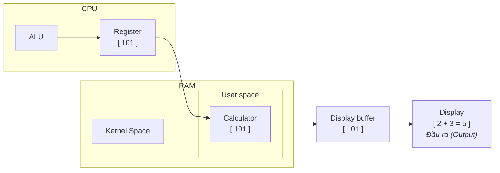
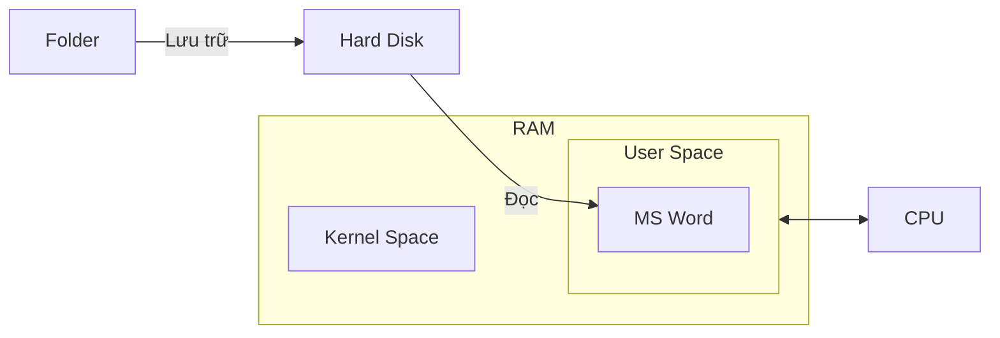
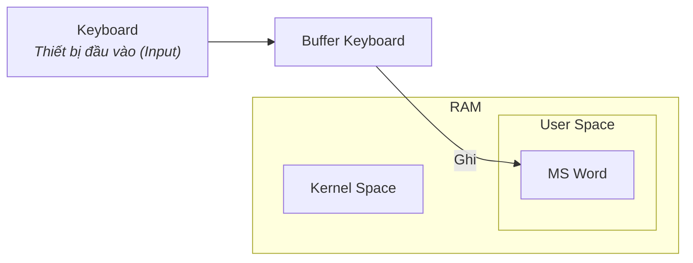

# Bài 4: Cách thức hoạt động phối hợp của các thiết bị đầu vào, đầu ra

## 1. Phân vùng bộ nhớ RAM: Kernel Space và User Space

- Khi bật máy tính, hệ điều hành (chính là một tập hợp các mã lệnh) sẽ được nạp ngay từ ổ cứng vào RAM.



- **Đặc tính của hệ điều hành (OS) trong RAM:** Mã hệ điều hành sẽ nằm thường trực trong RAM suốt quá trình máy tính hoạt động (chỉ mất khi tắt máy).
- **RAM được chia thành 2 vùng:**
  + **Kernel Space (Không gian hệ điều hành):** Nơi chứa toàn bộ mã nguồn, cấu trúc dữ liệu và các module quản lí của OS.
  + **User Space (Không gian người dùng):** Vùng nhớ còn lại dùng để nạp các chương trình ứng dụng do con người cài đặt và sử dụng như MS Word, Photoshop, Calculator,... Các tiến trình $P_1, P_2, P_3,...$ sẽ được cấp phát không gian tại đây.



---

## 2. Luồng thực thi của chương trình và cơ chế giao tiếp I/O qua Buffer

- Mã nguồn được biên dịch thành mã máy (`.exe`) nằm trên đĩa cứng. Khi cần chạy, nó được nạp vào User Space trên RAM. CPU sẽ tìm nạp (fetch) và thực thi (execute) từng lệnh. Khi tiến trình kết thúc, toàn bộ dữ liệu và không gian của nó trong RAM sẽ bị thu hồi hoàn toàn để nhường chỗ cho tiến trình khác.



- Khi kết thúc:

```mermaid
flowchart LR
    RESULT["Result<br/>(kết thúc)"] <-- "thực thi" -- CPU["CPU"]

    CPU -- "thu hồi main.exe" --> US

    subgraph RAM ["RAM"]
        direction TB
        KS["Kernel space"]
        US["User space"]
        KS ~~~ US
    end
```

- Trong quá trình chạy, chương trình cần tương tác bên ngoài thông qua các thiết bị vào/ra (I/O Devices).
- **Nguyên tắc cơ bản:** Mọi thiết bị I/O đều đi kèm một vùng nhớ đệm (Buffer / thanh ghi dữ liệu). Dữ liệu không đi thẳng từ phần cứng I/O vào lõi tính toán của CPU mà luôn trung chuyển qua **Buffer $\leftrightarrow$ RAM**.



### Minh họa qua 2 trường hợp:

#### Trường hợp 1: Ứng dụng Calculator ($2 + 3 = 5$)

- Khi người dùng bấm phím $2$ và $3$: Kí tự chuyển thành mã nhị phân (`010` và `011`) đi vào Keyboard buffer, sau đó chuyển tiếp vào RAM.
- CPU nạp các toán hạng này từ RAM vào thanh ghi nội bộ (Register).



- Khối tính toán số học và logic (ALU - Arithmetic and Logic Unit) của CPU kích hoạt mạch cộng tạo ra kết quả $5$ ($101_2$) và ghi vào một thanh ghi.
- Kết quả được đẩy lại RAM rồi chuyển tới Display Buffer (Bộ đệm màn hình để hiển thị ra pixel cho người dùng thấy).



---

#### Trường hợp 2: Chỉnh sửa tài liệu MS Word

- File tài liệu lưu trên ổ cứng được nạp lên RAM để CPU xử lí.
- Người dùng gõ bàn phím $\Rightarrow$ dữ liệu qua Buffer vào RAM để chắp nối vào văn bản.
- Khi bấm Save (Lưu vĩnh viễn): toàn bộ dữ liệu từ RAM được ghi xuống ổ cứng.





```mermaid
flowchart LR
    FOLDER["Folder"] <-- "Lưu trữ" -- DISK["Hard Disk"]
    DISK <-- "Ghi" -- WORD

    subgraph RAM ["RAM"]
        direction TB
        KS["Kernel Space"]
        subgraph US ["User Space"]
            WORD["MS Word"]
        end
        KS ~~~ US
    end

    CPU["CPU"] -- "Save" --> US
    US -- "Thực thi" --> CPU
```

=> **Ổ cứng vừa có thể đọc dữ liệu lên RAM, vừa có thể ghi dữ liệu từ RAM xuống nên ổ cứng đóng cả 2 vai trò: Thiết bị Input lẫn Output.**

---

## 3. Vòng đời tiến trình và khái niệm cốt lõi Turnaround Time

- Bất kì chương trình nào được nạp vào RAM cũng sẽ luân chuyển qua 3 trạng thái hoạt động chính:
  + **Running (Burst Time / Execution Time):** CPU đang trực tiếp xử lí các lệnh tính toán của chương trình.
  + **Waiting for I/O (I/O Time):** Chương trình tạm dừng chạy để chờ nhận dữ liệu từ bàn phím, chờ đọc/ghi ổ cứng, hoặc chờ xuất màn hình.
  + **Waiting (Waiting Time):** Chương trình nằm sẵn trong RAM nhưng phải chờ đến lượt được CPU cấp phát thời gian chạy (chờ scheduler điều phối).

- Thứ tự đan xen giữa tính toán (CPU burst) $\rightarrow$ Chờ I/O (I/O burst) $\rightarrow$ Chờ CPU (Waiting) sẽ tùy thuộc vào bản chất của từng chương trình cụ thể, không cố định.

---

### Công thức thời gian quay vòng (Turnaround Time):

- Khoảng thời gian tính từ khi một chương trình bắt đầu được nạp vào RAM cho đến khi kết thúc hoàn toàn và giải phóng khỏi RAM được gọi là **Turnaround Time (Thời gian quay vòng)**.

$$\text{Turnaround Time} = \text{Waiting Time} + \text{Burst Time (Execution Time)} + \text{I/O Time}$$

- **Ví dụ:** Một tiến trình $P_1$ được nạp vào RAM lúc 1:00 am và hoàn tất toàn bộ, giải phóng RAM lúc 3:00 am:
  $$\text{Turnaround Time} = 3\text{h} - 1\text{h} = 2\text{h}$$

=> **Trong suốt quá trình 2 tiếng này, thời gian của $P_1$ thực chất là tổng của:**
- Thời gian CPU bận xử lí nó (**Burst Time**)
- Thời gian thao tác nó đọc/ghi thiết bị (**I/O Time**)
- Thời gian nó phải nằm trong hàng đợi để nhường CPU cho tiến trình khác (**Waiting Time**)

---

### Như vậy:
- Việc hiểu rõ một tiến trình luôn tiêu tốn thời gian cho **Tính toán (Burst)**, **Vào/ra dữ liệu (I/O)** và **Chờ đợi (Waiting)** chính là tiền đề quan trọng nhất để bước vào phần: **Các thuật toán lập lịch CPU (CPU scheduler Algorithms)**, nơi Hệ điều hành tìm cách tối ưu hóa Turnaround Time và Waiting Time của toàn bộ hệ thống.
